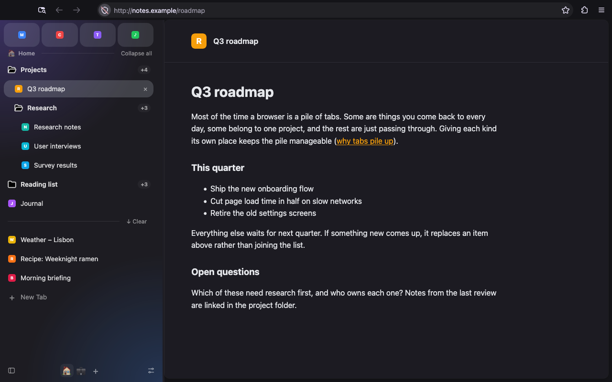
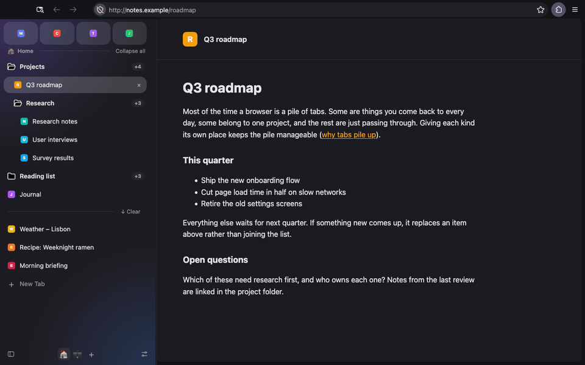
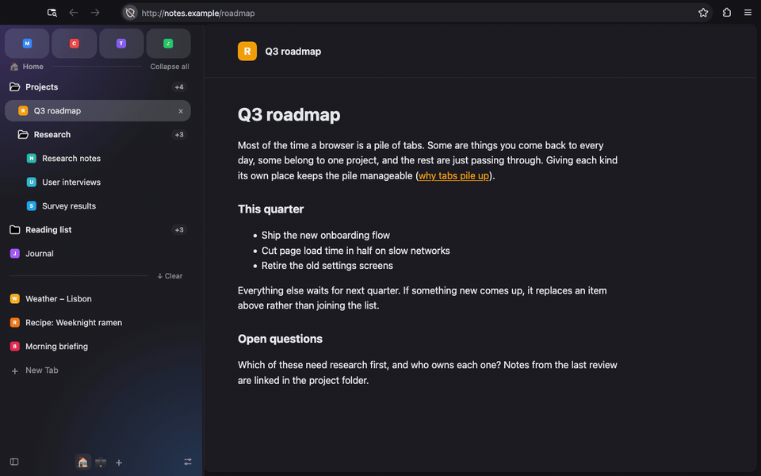
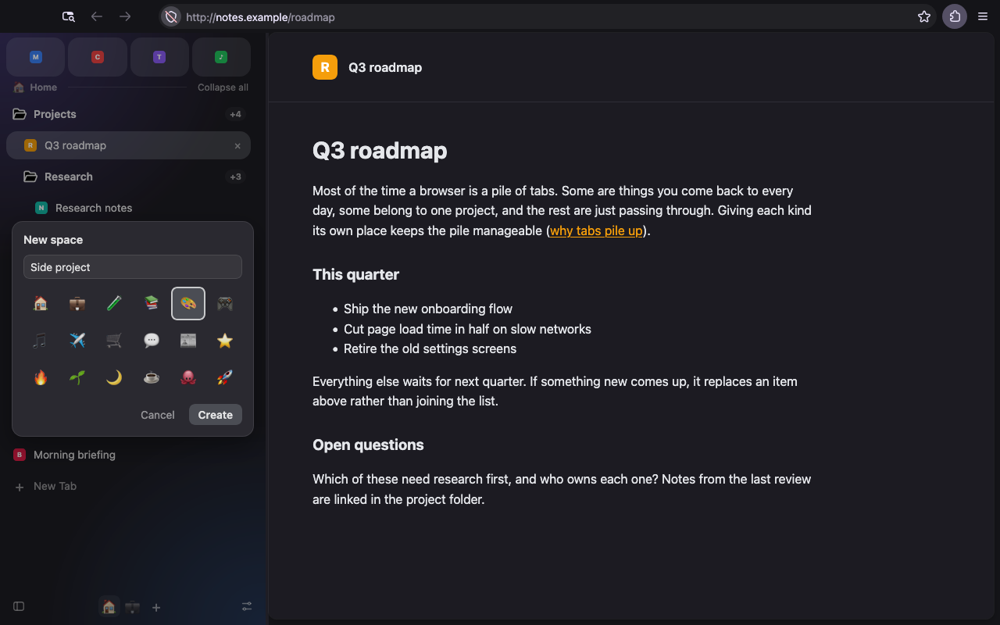
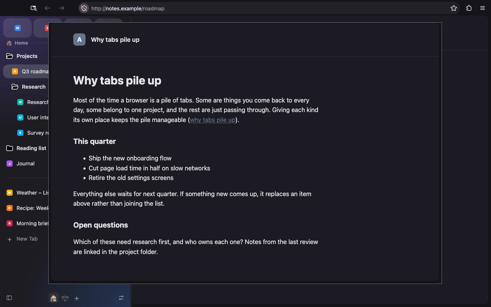
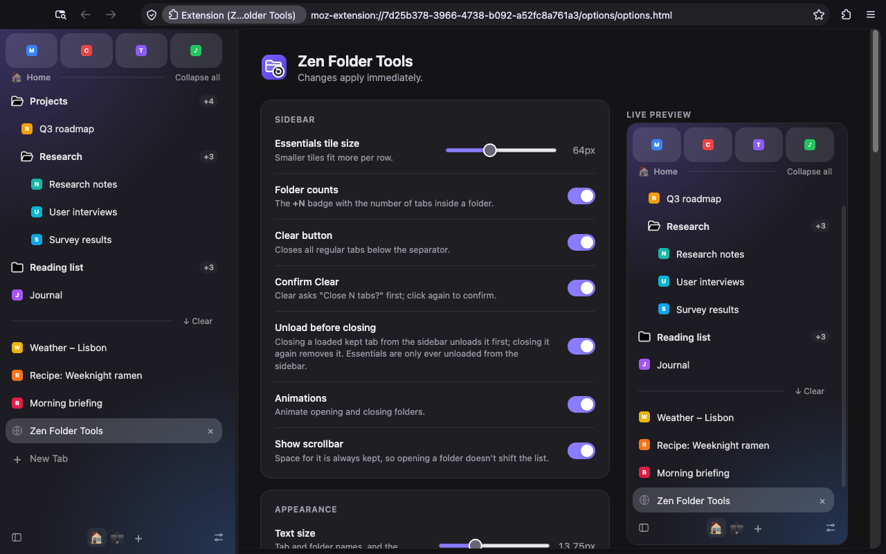
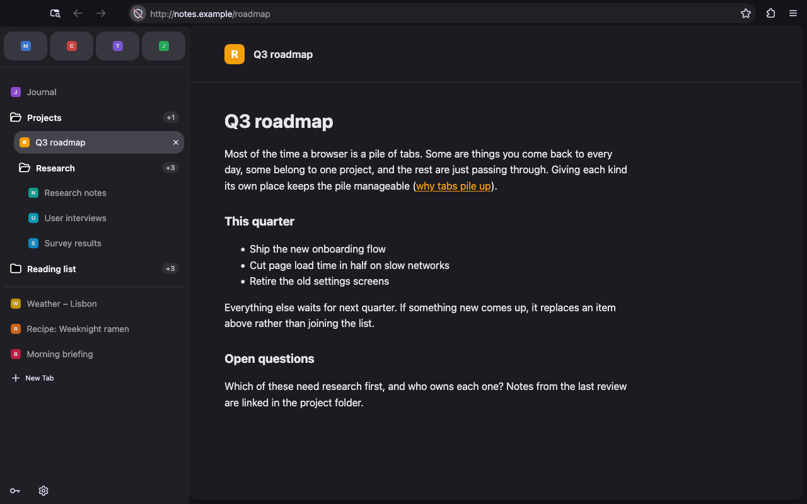

# firefox-zen

Make stock Firefox look and work like [Zen Browser](https://zen-browser.app/) on macOS: a vertical sidebar with Essentials, nested folders and spaces, Glance, and Zen's layout and styling.



It comes in two parts:

- **The setup** (`install.sh`): Firefox preferences (`user.js`) and a theme (`chrome/userChrome.css`) that restyle Firefox's own vertical tabs, toolbar, URL bar and page area. No extension needed.
- **Zen Folder Tools** (`extension/`): an optional extension that replaces Firefox's tab list with a Zen-style sidebar. It adds what CSS can't: real subfolders, spaces, Glance, close-to-unload, auto-unload and backups.

Tested with Firefox 160 (the "Nova" design) on macOS, compared side by side with Zen 1.24b.

## Quick start

Requires macOS and Python 3.

```sh
git clone https://github.com/manuelpuyol/firefox-zen.git
cd firefox-zen
./install.sh
```

Then load the extension: open `about:debugging#/runtime/this-firefox`, click **Load Temporary Add-on…** and pick `extension/manifest.json`. Firefox removes temporarily loaded extensions when it restarts; to keep it installed, [sign it](#installing-the-extension).

## Zen Folder Tools

The sidebar opens in Firefox's sidebar panel, and `userChrome.css` hides Firefox's own vertical tabs while it's open. Option+Shift+S, the sidebar button at the left of the toolbar, or Ctrl+Z (Control, not Cmd) show and hide it; the button at its bottom left hides it.

From top to bottom:

- **Essentials:** Firefox's pinned tabs, as tiles. They stay put while the list below scrolls; if they'd take more than half the sidebar, they scroll on their own.
- **The space's name**, and **Collapse all / Expand all** for its folders.
- **Kept tabs and folders:** tabs that stay around, in folders with real subfolders.
- **Clear:** closes this space's regular tabs. It asks "Close N tabs?" first; click again to confirm.
- **Regular tabs**, then **New Tab**.
- **The bottom bar:** hide button, space switcher (**+** makes a new space) and settings.

### Folders



- Subfolders are ordinary items: drag them anywhere among a folder's tabs. Folders can be empty, and each shows a `+N` count of every tab inside it, subfolders included.
- **Drag and drop:** drop on the top or bottom edge of a row to place before or after it, or on the middle of a folder to move into it. Drag between Essentials, kept and regular tabs. Firefox's own tab order follows the sidebar.
- **Close to unload:** closing a loaded Essential or kept tab from the sidebar (× or middle-click) unloads it; closing it again closes it. Essentials are only ever unloaded this way. Cmd+W always closes, because extensions can't take it over.
- **Reset:** a kept tab remembers the address it had when it was kept. When it has navigated away, a ↺ button takes it back (also **Reset to Original URL** in the tab menu, or Option+Shift+R). **Use Current Page as Original URL** changes it.
- **Select several tabs:** Shift+click selects a range, Cmd+click adds or removes one, Escape clears. This is Firefox's own selection, so Cmd+W, the tab menu, dragging and × act on all of them. **Copy N URLs** in the tab menu copies their addresses, one per line.
- **Menus:** right-clicking a tab shows Firefox's tab menu plus *Keep in Sidebar*, *Move to Regular Tabs*, *Move to New Folder*, *Move to Space* and the reset items. Right-clicking a folder or an empty area offers *New Folder*, *New Subfolder*, *Rename Folder*, *Remove Folder (Keep Tabs)* and *Move Folder to Space*.
- **Firefox tab groups become folders.** Existing groups are converted when the extension is installed, including the leading-space subfolder convention [the setup](#the-setup-on-its-own) uses. A group made later with Firefox's own menu becomes a folder once its name has stopped changing for a second. Turn this off in settings to keep Firefox's groups. Groups in private windows are left alone, since folders are shared by all windows and saved on disk.

### Spaces



Each window shows one space at a time, with its own kept tabs, folders and regular tabs. Essentials are shared by every space.

- **Switch** by clicking a space's icon at the bottom, swiping sideways with two fingers over the sidebar, or with Ctrl+Option+→ and Ctrl+Option+←. Switching goes to the space's most recently used tab.
- **+** asks for a name and an icon, then switches to the new space.

  

- **Right-click a space** (its icon, or its name under the Essentials) to rename it, change its icon, give it its own background, move it left or right, or delete it. Double-click the name to rename it. Deleting a space never closes tabs: they and its folders move to the space before it.
- **Move tabs and folders between spaces** with *Move to Space* in the tab menu and *Move Folder to Space* in the folder menu. A kept tab moved on its own goes to the other space's top level, since a folder belongs to one space.
- New tabs open in the current space. Switching to a tab from another space (for example *Switch to Tab* in the address bar) switches to its space. A tab dragged to another window joins that window's space.
- Each window remembers its space across restarts, and a new window starts in the space of the window it was opened from.

Other spaces' tabs are hidden in Firefox (with the *tabHide* permission), so Ctrl+Tab, Cmd+1–9, the tab list and tab search only see the current space. Hidden tabs keep running, and auto-unload unloads them like any other tab.

- Firefox can't hide a tab that's sharing the camera, microphone or screen. Such a tab stays listed, marked with its space's icon, in whichever space is shown until it stops sharing. Clear leaves it alone, and dragging it into the shown space moves it there.
- If the extension is turned off or removed, Firefox shows every tab again. Nothing is closed, and each tab goes back to its space when the extension is back.
- A temporarily loaded extension is the exception: Firefox restarts with other spaces' tabs still hidden and the extension gone. Load it again from `about:debugging` to get them back. A signed, installed extension doesn't have this problem.

### Glance



Option+click a link in a page to open it in a floating window in the middle of the current one.

- Escape, or clicking back on the main window, closes it. Option+Shift+G moves it into the main window as a tab next to the one it came from, keeping the page as it is.
- One Glance per window: Option+clicking again reuses it. In a private window it opens a private Glance.
- It needs access to websites, an optional permission that you allow from the settings page (turning Glance on asks for it). Glance's script only runs in pages while Glance is on and access is granted. Without it, the extension can't see or change any web page.
- Only real clicks count, so a page can't open a Glance by faking one. Links inside embedded frames aren't covered.
- It's off in container tabs: keeping a container's cookies would need the *cookies* permission, which would let the extension read every site's cookies. Option+click works as usual there.

### Auto-unload

Every 5 minutes, tabs you haven't looked at for an hour are unloaded, with the same rules as [Zen Stale Tabs](https://github.com/manuelpuyol/zen-stale-pinned-tabs). Never unloaded:

- Essentials. Firefox's own low-memory unloader is told to skip them too; turn off *Keep Essentials loaded* to allow it. The extension only removes protection it set, so other extensions' protection stays.
- The current tab, and tabs that are playing audio, using the camera, microphone or screen sharing, still loading, in a private window, or protected by another extension.
- Addresses on your *Never unload* list (one per line, `*` matches anything).

### Settings



The gear at the bottom of the sidebar (or `about:addons` → Zen Folder Tools → Preferences) opens the settings, with a live preview of your sidebar. Changes apply immediately.

- **Sidebar:** Essentials tile size, folder counts, the Clear button and its confirmation, unloading before closing, animations, and the scrollbar.
- **Appearance:** text size, row height, folder indent, how much of the sidebar the Essentials may take, and the background: Aurora (the default), Sunset, Ocean, Forest, Graphite or Plain.
- **Folders:** turning Firefox tab groups into folders, importing folders from Zen, and backups.
- **Auto-unload:** on or off, idle time, how often to check, the last run, and *Unload idle tabs now*.
- **Glance:** on or off, access to websites, and window size.
- **Keyboard shortcuts:** the current shortcuts, with a link to Firefox's shortcut editor.

### Backups

**Export…** saves your spaces, folders, kept tabs (folder, position, address, original address and space) and Essentials to a JSON file. **Restore…** adds back what's missing and never removes anything:

- Spaces with the same name, and folders with the same name, parent and space, are reused. Files from before spaces existed restore into the current space.
- Open tabs with a matching address move into their folder, and missing tabs reopen unloaded.
- The whole file is checked before anything changes.
- Private windows aren't exported. Tabs are only matched within their own container, and tabs from containers aren't reopened, because that needs the *cookies* permission. Open them in their container and restore again.

The extension also protects your folders on its own:

- Firefox deletes an extension's data when it's removed, and a temporarily loaded one is removed on every restart or reload. `user.js` sets `extensions.webextensions.keepStorageOnUninstall` and `keepUuidOnUninstall` to keep it. The side effect is that uninstalled extensions leave their data behind.
- Every folder and space change is also saved with your windows in Firefox's session, and restored from there if the extension's own copy is gone.
- Tabs that point at a folder that no longer exists are grouped into *Recovered folder N* folders instead of being scattered.

### Installing the extension

Release Firefox only installs signed extensions. To keep it installed:

1. Build it: `npm install`, then `npm run build` (into `dist/`).
2. Submit the zip to [addons.mozilla.org](https://addons.mozilla.org/developers/) as an unlisted add-on.
3. Install the signed `.xpi` it returns.

## The setup on its own



Without the extension, `install.sh` still gives you:

- **Sidebar:** Firefox's vertical tabs, 300px wide, without Firefox's tool buttons. Ctrl+Z shows and hides it.
- **Essentials:** pinned tabs as a grid of rounded tiles.
- **Folders:** tab groups restyled as Zen folders, with a folder icon that opens and closes, a `+N` count and animation. Hovering a closed folder for a second shows its tabs; that delay applies to all Firefox tooltips and is set with `ui.tooltip.delay_ms`.
- **Subfolders:** a group whose name starts with a space nests under the group above it (two spaces for two levels). It's shown after that folder's own tabs, because the rules needed to move it above them crash Firefox when a tooltip opens.
- **Tab rows** with Zen's measurements for hover and selection. Unloaded tabs are greyed out, and a line separates folders from other tabs.
- **Floating URL bar:** on a new tab or when you start typing, the URL bar and its suggestions move to the middle of the window.
- **Page area:** rounded, floating web content with a soft shadow.
- **Translucent sidebar and toolbar,** using the macOS sidebar material without Nova's purple tint.
- **Toolbar:** sidebar toggle, back, forward, reload, URL bar, extensions.
- **Sessions:** your previous session is restored and pinned tabs stay loaded. Containers are on, and sponsored content is off.

The extension's own sidebar panel is solid rather than translucent. The only way to make it see-through (`browser.tabs.allow_transparent_browser`) also makes web pages without a background of their own see-through, so `user.js` keeps it off.

### How install.sh works

macOS doesn't let other apps write to Firefox's profile folder. So `install.sh` quits Firefox, restarts it with Marionette (Firefox's remote-control protocol), has Firefox copy the files into its own profile, then restarts Firefox normally. Your previous `user.js`, `chrome/` and session are backed up to `<profile>/zen-kit-backup-*`.

It also switches Firefox to its default (system) theme, because any add-on theme paints the window opaque and hides the translucency.

### Moving from Zen

`./install.sh --import-zen` replaces your current tabs with your Zen session (`zen-sessions.jsonlz4`):

| Zen | Firefox |
| --- | --- |
| Essentials | Pinned tabs |
| Folders | Tab groups (folders, once the extension is loaded) |
| Subfolders | Tab groups whose name starts with a space |
| Pinned tabs in folders | Tabs in those groups |
| Other tabs | Regular tabs after the groups |

Tabs from every Zen space are imported into one window and one space.

If your tabs are already open in Firefox, run `python3 scripts/export_zen_folders.py` instead. It writes `~/Downloads/zen-folders.json`; use **Import folders from Zen** on the extension's settings page to recreate the folders. Open tabs with matching addresses move into them, and emptied *Recovered* folders are removed.

## Customising

- `user.js`: Firefox preferences, applied on every launch. To undo one, delete its line and reset it in `about:config`.
- `chrome/userChrome.css`: the theme. Edit above the `@generated` marker; the variables at the top control spacing, radius, colours and animation speed. Then run `python3 scripts/generate_css.py` to rebuild the generated rules (folder counts and subfolder collapsing).

Run `./install.sh` again to apply changes.

## Limitations

What Zen does that this can't:

- **Translucency:** Zen uses a darker macOS material (HUD) that Firefox doesn't expose, so the sidebar is tinted with CSS instead. The extension's panel isn't translucent at all (see [above](#the-setup-on-its-own)).
- **Swiping between spaces** only works over the sidebar, not over the page.
- **Cmd+W** always closes; only closing from the sidebar unloads first.
- **Glance** is a separate window rather than an overlay inside the page.
- **New tabs:** Firefox creates the tab straight away; Zen waits until you press Enter in the floating URL bar.
- **Without the extension:** there are no spaces, folder tabs are regular tabs in a group, and subfolders are a naming convention. Firefox tab groups can't nest, so dragging a subfolder or dropping a tab into one doesn't work reliably, and a folder's `+N` count leaves out its subfolders.

## Development

Install the dev dependencies once with `npm install` (Node 20 or newer).

- `npm test`: about 190 unit and DOM tests, in about 30 seconds and without a browser. They run on [Vitest](https://vitest.dev/) against a stand-in for Firefox's extension API (`test/support/firefox.js`). Storage and alarms come from [`@webext-core/fake-browser`](https://webext-core.aklinker1.io/fake-browser/installation). Tabs, windows, sessions, tab groups, menus and messaging are written to behave like Firefox: for example, it can't hide active, pinned or sharing tabs. The sidebar, settings page and Glance's page script run in [happy-dom](https://github.com/capricorn86/happy-dom) with their real HTML and scripts, talking to the real background script.
- `npm run test:coverage`: the same, with a coverage report (about 98% of statements).
- `npm run test:e2e`: end-to-end tests in real, headless Firefox, in about 10 seconds; set `HEADED=1` to watch. [Selenium](https://www.selenium.dev/documentation/webdriver/) drives Firefox through geckodriver, which Selenium Manager downloads the first time. Each run uses a throwaway profile made from `user.js` and `userChrome.css`, with the extension loaded temporarily, so your own profile isn't touched. They cover the theme, spaces hiding tabs in Firefox's tab strip, turning the extension off and on, Glance, the tab menu, Copy URL, Clear, unloading, restoring a backup, and recovering folders from Firefox's session data. Not covered in real Firefox: tabs in a call (headless Firefox doesn't report its fake camera as sharing, so the unit tests cover them), dragging in the sidebar, trackpad swipes, and restarting Firefox.
- `npm run lint`: [ESLint](https://eslint.org/)'s recommended rules, then `web-ext lint` (Mozilla's add-on checks).
- `npm run build`: the extension's zip, in `dist/`.
- `npm run screenshots`: regenerates the images in this README with real, headless Firefox and made-up pages (needs ffmpeg). Headless Firefox can't draw macOS's translucent material, so a dark colour stands in for it.

## License

[MIT](LICENSE)
